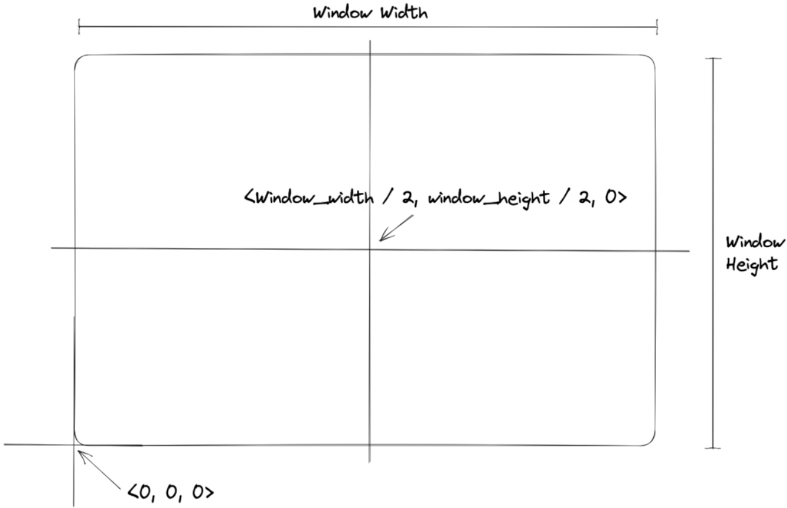
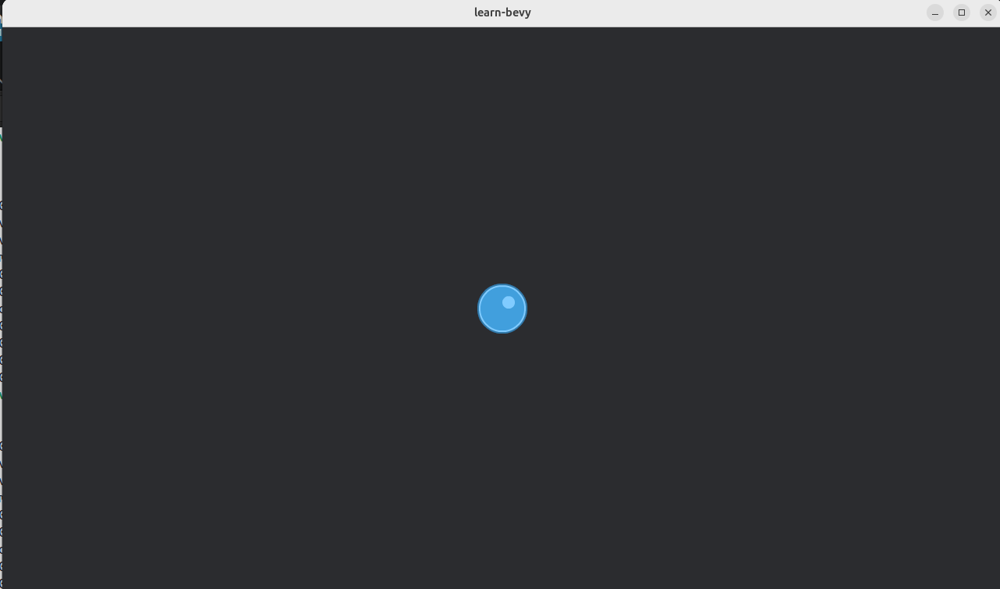

# EP2

Based on https://www.youtube.com/watch?v=izhFutJiZgo&list=PLVnntJRoP85JHGX7rGDu6LaF3fmDDbqyd&index=2 

Using game resources from: https://kenney.nl/

## Step 1 
Setup the environment

```rust
use bevy::prelude::*;

pub fn ep20() {
    App::new().add_plugins(DefaultPlugins).run();
}

```

Running
```bash
$ cargo run 20
   Compiling learn-bevy v0.1.0 (/home/bvpelt/Develop/learn-bevy)
    Finished `dev` profile [unoptimized + debuginfo] target(s) in 0.87s
     Running `target/debug/learn-bevy 20`
```
The application stops execution after startup


## Step 2
Using bundles and resources

A bundle is a set of Components.
Bundles are used:
- to easily add or remove sets of components to or from an entity
- typically, a certain set of components are required to producer certain functionallity. This shorthand is useful.
- a bundle can contain bevy components or/and user defined components

A resource is a unique and globally accissible struct.
*Only one Resource of type &lt;T&gt; can exists at any given time*

We can use Resources in our systems as system parameters using:
- Res&lt;T&gt; (Read-only)
- ResMut&lt;T&gt; (Mutable)

To setup use Transform to get the origin in the center



```rust
use bevy::{prelude::*, window::PrimaryWindow};

pub fn ep20() {
    App::new()
        .add_plugins(DefaultPlugins)
        .add_systems(Startup, spawn_camera)
        .add_systems(Startup, spawn_player)
        .run();
}

#[derive(Component)]
pub struct Player {}

pub fn spawn_player(
    mut commands: Commands,
    window_query: Query<&Window, With<PrimaryWindow>>,
    asset_server: Res<AssetServer>,
) {
    let window = window_query.single().unwrap();

    commands.spawn((
        Sprite {
            image: asset_server.load("sprites/ball_blue_large.png"),
            ..default()
        },
        Transform::from_xyz(window.width() / 2.0, window.height() / 2.0, 0.0),
        Player {},
    ));
}

pub fn spawn_camera(mut commands: Commands, window_query: Query<&Window, With<PrimaryWindow>>) {
    let window = window_query.single().unwrap();

    commands.spawn((
        Camera2d { ..default() },
        Transform::from_xyz(window.width() / 2.0, window.height() / 2.0, 0.0),
    ));
}
```

Running
```bash
$ cargo run 20
   Compiling learn-bevy v0.1.0 (/home/bvpelt/Develop/learn-bevy)
    Finished `dev` profile [unoptimized + debuginfo] target(s) in 0.58s
     Running `target/debug/learn-bevy 20`
2026-10-14T11:38:32.192933Z  INFO bevy_render::renderer: AdapterInfo { name: "Intel(R) Graphics (MTL)", vendor: 32902, device: 32069, device_type: IntegratedGpu, device_pci_bus_id: "0000:00:02.0", driver: "Intel open-source Mesa driver", driver_info: "Mesa 25.2.8-0ubuntu0.24.04.4", backend: Vulkan, subgroup_min_size: 8, subgroup_max_size: 32, transient_saves_memory: false }
2026-10-14T11:38:32.589162Z  INFO bevy_pbr::cluster: GPU clustering is supported on this device.
2026-10-14T11:38:32.589291Z  INFO bevy_render::batching::gpu_preprocessing: GPU preprocessing is fully supported on this device.
2026-10-14T11:38:32.591507Z  INFO bevy_winit::system: Creating new window learn-bevy (65v0)
2026-10-14T11:38:32.593394Z  INFO winit::platform_impl::linux::x11::window: Guessed window scale factor: 1
2026-10-14T11:38:34.726449Z  INFO bevy_window::system: No windows are open, exiting
2026-10-14T11:38:34.726564Z  INFO bevy_winit::system: Closing window 65v0
```

This opens a window


Here we learned
- First game setup
- Assets
- Bundles
- Resources
- 2D Rendering
- More commands