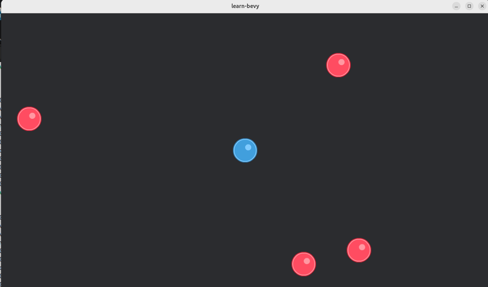

# EP3

Based on https://www.youtube.com/watch?v=xnGMw5j5Xdo&list=PLVnntJRoP85JHGX7rGDu6LaF3fmDDbqyd&index=3

Learning targets
- Moving the player with the keyboard input
- Keeping the player inside the window
- Spawning enemies


## Step 1
Add control using keyboard

```rust
use bevy::{prelude::*, window::PrimaryWindow};

pub fn ep30() {
    App::new()
        .add_plugins(DefaultPlugins)
        .add_systems(Startup, spawn_camera)
        .add_systems(Startup, spawn_player)
        .add_systems(Update, player_movement)
        .run();
}

#[derive(Component)]
pub struct Player {}

#[derive(Component)]
pub struct Enemy {}

pub fn spawn_player(
    mut commands: Commands,
    window_query: Query<&Window, With<PrimaryWindow>>,
    asset_server: Res<AssetServer>,
) {
    let window = window_query.single().unwrap();

    commands.spawn((
        Sprite {
            image: asset_server.load("sprites/ball_blue_large.png"),
            ..default()
        },
        Transform::from_xyz(window.width() / 2.0, window.height() / 2.0, 0.0),
        Player {},
    ));
}

pub fn spawn_camera(mut commands: Commands, window_query: Query<&Window, With<PrimaryWindow>>) {
    let window = window_query.single().unwrap();

    commands.spawn((
        Camera2d { ..default() },
        Transform::from_xyz(window.width() / 2.0, window.height() / 2.0, 0.0),
    ));
}

pub const PLAYER_SPEED: f32 = 500.0;

pub fn player_movement(
    keyboard_input: Res<ButtonInput<KeyCode>>,
    mut player_query: Query<&mut Transform, With<Player>>,
    time: Res<Time>,
) {
    if let Ok(mut transform) = player_query.single_mut() {
        let mut direction = Vec3::ZERO;

        if keyboard_input.pressed(KeyCode::ArrowLeft)
            || keyboard_input.pressed(KeyCode::Numpad4)
            || keyboard_input.pressed(KeyCode::KeyA)
        {
            direction += Vec3::new(-1.0, 0.0, 0.0);
        }

        if keyboard_input.pressed(KeyCode::ArrowRight)
            || keyboard_input.pressed(KeyCode::Numpad6)
            || keyboard_input.pressed(KeyCode::KeyD)
        {
            direction += Vec3::new(1.0, 0.0, 0.0);
        }

        if keyboard_input.pressed(KeyCode::ArrowUp)
            || keyboard_input.pressed(KeyCode::Numpad8)
            || keyboard_input.pressed(KeyCode::KeyW)
        {
            direction += Vec3::new(0.0, 1.0, 0.0);
        }

        if keyboard_input.pressed(KeyCode::ArrowDown)
            || keyboard_input.pressed(KeyCode::Numpad2)
            || keyboard_input.pressed(KeyCode::KeyS)
        {
            direction += Vec3::new(0.0, -1.0, 0.0);
        }

        if direction.length() > 0.0 {
            direction = direction.normalize();
        }

        // using time.delta_seconds() ensures that the movement is frame-rate independent, meaning the player will move at the same speed regardless of the frame rate.
        // time is the time since the last frame, so multiplying the speed by this value ensures that the player moves at a consistent speed over time.
        transform.translation += direction * PLAYER_SPEED * time.delta_secs();
    }
}

```

```bash
$ cargo run 30
   Compiling learn-bevy v0.1.0 (/home/bvpelt/Develop/learn-bevy)
    Finished `dev` profile [unoptimized + debuginfo] target(s) in 0.61s
     Running `target/debug/learn-bevy 30`
2026-10-14T12:17:10.944000Z  INFO bevy_render::renderer: AdapterInfo { name: "Intel(R) Graphics (MTL)", vendor: 32902, device: 32069, device_type: IntegratedGpu, device_pci_bus_id: "0000:00:02.0", driver: "Intel open-source Mesa driver", driver_info: "Mesa 25.2.8-0ubuntu0.24.04.4", backend: Vulkan, subgroup_min_size: 8, subgroup_max_size: 32, transient_saves_memory: false }
2026-10-14T12:17:11.345516Z  INFO bevy_pbr::cluster: GPU clustering is supported on this device.
2026-10-14T12:17:11.345657Z  INFO bevy_render::batching::gpu_preprocessing: GPU preprocessing is fully supported on this device.
2026-10-14T12:17:11.347894Z  INFO bevy_winit::system: Creating new window learn-bevy (65v0)
2026-10-14T12:17:11.349230Z  INFO winit::platform_impl::linux::x11::window: Guessed window scale factor: 1
2026-10-14T12:17:16.237877Z  INFO bevy_window::system: No windows are open, exiting
2026-10-14T12:17:16.237974Z  INFO bevy_winit::system: Closing window 65v0
```
The window with the blue ball opens and the movement of the ball can be controlled using the arrowkeys or wasd. 

*Mind you, the ball can get out of the window.*

## Step 2
Confine player within window by adding the confine_player_movement function


```rust
use bevy::{prelude::*, window::PrimaryWindow};

pub const PLAYER_SPEED: f32 = 500.0;
pub const PLAYER_SIZE: f32 = 64.0; // This is the player sprite size.

pub fn ep30() {
    App::new()
        .add_plugins(DefaultPlugins)
        .add_systems(Startup, spawn_camera)
        .add_systems(Startup, spawn_player)
        .add_systems(Update, player_movement)
        .add_systems(Update, confine_player_movement)
        .run();
}

#[derive(Component)]
pub struct Player {}

pub fn spawn_player(
    mut commands: Commands,
    window_query: Query<&Window, With<PrimaryWindow>>,
    asset_server: Res<AssetServer>,
) {
    let window = window_query.single().unwrap();

    commands.spawn((
        Sprite {
            image: asset_server.load("sprites/ball_blue_large.png"),
            ..default()
        },
        Transform::from_xyz(window.width() / 2.0, window.height() / 2.0, 0.0),
        Player {},
    ));
}

pub fn spawn_camera(mut commands: Commands, window_query: Query<&Window, With<PrimaryWindow>>) {
    let window = window_query.single().unwrap();

    commands.spawn((
        Camera2d { ..default() },
        Transform::from_xyz(window.width() / 2.0, window.height() / 2.0, 0.0),
    ));
}

pub fn player_movement(
    keyboard_input: Res<ButtonInput<KeyCode>>,
    mut player_query: Query<&mut Transform, With<Player>>,
    time: Res<Time>,
) {
    if let Ok(mut transform) = player_query.single_mut() {
        let mut direction = Vec3::ZERO;

        if keyboard_input.pressed(KeyCode::ArrowLeft)
            || keyboard_input.pressed(KeyCode::Numpad4)
            || keyboard_input.pressed(KeyCode::KeyA)
        {
            direction += Vec3::new(-1.0, 0.0, 0.0);
        }

        if keyboard_input.pressed(KeyCode::ArrowRight)
            || keyboard_input.pressed(KeyCode::Numpad6)
            || keyboard_input.pressed(KeyCode::KeyD)
        {
            direction += Vec3::new(1.0, 0.0, 0.0);
        }

        if keyboard_input.pressed(KeyCode::ArrowUp)
            || keyboard_input.pressed(KeyCode::Numpad8)
            || keyboard_input.pressed(KeyCode::KeyW)
        {
            direction += Vec3::new(0.0, 1.0, 0.0);
        }

        if keyboard_input.pressed(KeyCode::ArrowDown)
            || keyboard_input.pressed(KeyCode::Numpad2)
            || keyboard_input.pressed(KeyCode::KeyS)
        {
            direction += Vec3::new(0.0, -1.0, 0.0);
        }

        if direction.length() > 0.0 {
            direction = direction.normalize();
        }

        // using time.delta_seconds() ensures that the movement is frame-rate independent, meaning the player will move at the same speed regardless of the frame rate.
        // time is the time since the last frame, so multiplying the speed by this value ensures that the player moves at a consistent speed over time.
        transform.translation += direction * PLAYER_SPEED * time.delta_secs();
    }
}

pub fn confine_player_movement(
    mut player_query: Query<&mut Transform, With<Player>>,
    window_query: Query<&Window, With<PrimaryWindow>>,
) {
    if let Ok(mut player_transform) = player_query.single_mut() {
        let window = window_query.single().unwrap();

        let half_player_size = PLAYER_SIZE / 2.0;
        let x_min = half_player_size;
        let x_max = window.width() - half_player_size;
        let y_min = half_player_size;
        let y_max = window.height() - half_player_size;

        let mut translation = player_transform.translation;

        // Bound player x position
        if translation.x < x_min {
            translation.x = x_min;
        } else if translation.x > x_max {
            translation.x = x_max;
        }

        // Bound player y position
        if translation.y < y_min {
            translation.y = y_min;
        } else if translation.y > y_max {
            translation.y = y_max;
        }

        player_transform.translation = translation;
    }
}

```

```bash
$ cargo run 30
   Compiling learn-bevy v0.1.0 (/home/bvpelt/Develop/learn-bevy)
    Finished `dev` profile [unoptimized + debuginfo] target(s) in 1.15s
     Running `target/debug/learn-bevy 30`
2026-10-14T12:30:16.212912Z  INFO bevy_render::renderer: AdapterInfo { name: "Intel(R) Graphics (MTL)", vendor: 32902, device: 32069, device_type: IntegratedGpu, device_pci_bus_id: "0000:00:02.0", driver: "Intel open-source Mesa driver", driver_info: "Mesa 25.2.8-0ubuntu0.24.04.4", backend: Vulkan, subgroup_min_size: 8, subgroup_max_size: 32, transient_saves_memory: false }
2026-10-14T12:30:16.617989Z  INFO bevy_pbr::cluster: GPU clustering is supported on this device.
2026-10-14T12:30:16.618120Z  INFO bevy_render::batching::gpu_preprocessing: GPU preprocessing is fully supported on this device.
2026-10-14T12:30:16.620364Z  INFO bevy_winit::system: Creating new window learn-bevy (65v0)
2026-10-14T12:30:16.622594Z  INFO winit::platform_impl::linux::x11::window: Guessed window scale factor: 1
2026-10-14T12:30:36.061181Z  INFO bevy_window::system: No windows are open, exiting
2026-10-14T12:30:36.061288Z  INFO bevy_winit::system: Closing window 65v0
```
The window startsup and the ball stays within the window when using the arrow keys.

## Step 3
Add enemies

```rust
use bevy::{prelude::*, window::PrimaryWindow};
use rand::prelude::*;

pub const PLAYER_SPEED: f32 = 500.0;
pub const PLAYER_SIZE: f32 = 64.0; // This is the player sprite size.
pub const NUMBER_OF_ENEMIES: usize = 4;

pub fn ep30() {
    App::new()
        .add_plugins(DefaultPlugins)
        .add_systems(Startup, spawn_camera)
        .add_systems(Startup, spawn_player)
        .add_systems(Startup, spawn_enemies)
        .add_systems(Update, player_movement)
        .add_systems(Update, confine_player_movement)
        .run();
}

#[derive(Component)]
pub struct Player {}

#[derive(Component)]
pub struct Enemy {}

pub fn spawn_player(
    mut commands: Commands,
    window_query: Query<&Window, With<PrimaryWindow>>,
    asset_server: Res<AssetServer>,
) {
    let window = window_query.single().unwrap();

    commands.spawn((
        Sprite {
            image: asset_server.load("sprites/ball_blue_large.png"),
            ..default()
        },
        Transform::from_xyz(window.width() / 2.0, window.height() / 2.0, 0.0),
        Player {},
    ));
}

pub fn spawn_camera(mut commands: Commands, window_query: Query<&Window, With<PrimaryWindow>>) {
    let window = window_query.single().unwrap();

    commands.spawn((
        Camera2d { ..default() },
        Transform::from_xyz(window.width() / 2.0, window.height() / 2.0, 0.0),
    ));
}

pub fn spawn_enemies(
    mut commands: Commands,
    window_query: Query<&Window, With<PrimaryWindow>>,
    asset_server: Res<AssetServer>,
) {
    let window = window_query.single().unwrap();
    let mut rng = rand::rng();

    for _ in 0..NUMBER_OF_ENEMIES {
        let x = rng.random_range(0.0..window.width());
        let y = rng.random_range(0.0..window.height());

        commands.spawn((
            Sprite {
                image: asset_server.load("sprites/ball_red_large.png"),
                ..default()
            },
            Transform::from_xyz(x, y, 0.0),
            Enemy {},
        ));
    }
}

pub fn player_movement(
    keyboard_input: Res<ButtonInput<KeyCode>>,
    mut player_query: Query<&mut Transform, With<Player>>,
    time: Res<Time>,
) {
    if let Ok(mut transform) = player_query.single_mut() {
        let mut direction = Vec3::ZERO;

        if keyboard_input.pressed(KeyCode::ArrowLeft)
            || keyboard_input.pressed(KeyCode::Numpad4)
            || keyboard_input.pressed(KeyCode::KeyA)
        {
            direction += Vec3::new(-1.0, 0.0, 0.0);
        }

        if keyboard_input.pressed(KeyCode::ArrowRight)
            || keyboard_input.pressed(KeyCode::Numpad6)
            || keyboard_input.pressed(KeyCode::KeyD)
        {
            direction += Vec3::new(1.0, 0.0, 0.0);
        }

        if keyboard_input.pressed(KeyCode::ArrowUp)
            || keyboard_input.pressed(KeyCode::Numpad8)
            || keyboard_input.pressed(KeyCode::KeyW)
        {
            direction += Vec3::new(0.0, 1.0, 0.0);
        }

        if keyboard_input.pressed(KeyCode::ArrowDown)
            || keyboard_input.pressed(KeyCode::Numpad2)
            || keyboard_input.pressed(KeyCode::KeyS)
        {
            direction += Vec3::new(0.0, -1.0, 0.0);
        }

        if direction.length() > 0.0 {
            direction = direction.normalize();
        }

        // using time.delta_seconds() ensures that the movement is frame-rate independent, meaning the player will move at the same speed regardless of the frame rate.
        // time is the time since the last frame, so multiplying the speed by this value ensures that the player moves at a consistent speed over time.
        transform.translation += direction * PLAYER_SPEED * time.delta_secs();
    }
}

pub fn confine_player_movement(
    mut player_query: Query<&mut Transform, With<Player>>,
    window_query: Query<&Window, With<PrimaryWindow>>,
) {
    if let Ok(mut player_transform) = player_query.single_mut() {
        let window = window_query.single().unwrap();

        let half_player_size = PLAYER_SIZE / 2.0;
        let x_min = half_player_size;
        let x_max = window.width() - half_player_size;
        let y_min = half_player_size;
        let y_max = window.height() - half_player_size;

        let mut translation = player_transform.translation;

        // Bound player x position
        if translation.x < x_min {
            translation.x = x_min;
        } else if translation.x > x_max {
            translation.x = x_max;
        }

        // Bound player y position
        if translation.y < y_min {
            translation.y = y_min;
        } else if translation.y > y_max {
            translation.y = y_max;
        }

        player_transform.translation = translation;
    }
}

```

Running
```bash
$ cargo run 30
   Compiling learn-bevy v0.1.0 (/home/bvpelt/Develop/learn-bevy)
    Finished `dev` profile [unoptimized + debuginfo] target(s) in 0.98s
     Running `target/debug/learn-bevy 30`
2026-10-14T12:47:29.064940Z  INFO bevy_render::renderer: AdapterInfo { name: "Intel(R) Graphics (MTL)", vendor: 32902, device: 32069, device_type: IntegratedGpu, device_pci_bus_id: "0000:00:02.0", driver: "Intel open-source Mesa driver", driver_info: "Mesa 25.2.8-0ubuntu0.24.04.4", backend: Vulkan, subgroup_min_size: 8, subgroup_max_size: 32, transient_saves_memory: false }
2026-10-14T12:47:29.490199Z  INFO bevy_pbr::cluster: GPU clustering is supported on this device.
2026-10-14T12:47:29.490328Z  INFO bevy_render::batching::gpu_preprocessing: GPU preprocessing is fully supported on this device.
2026-10-14T12:47:29.492504Z  INFO bevy_winit::system: Creating new window learn-bevy (65v0)
2026-10-14T12:47:29.494308Z  INFO winit::platform_impl::linux::x11::window: Guessed window scale factor: 1
2026-10-14T12:47:34.809369Z  INFO bevy_window::system: No windows are open, exiting
2026-10-14T12:47:34.809482Z  INFO bevy_winit::system: Closing window 65v0

```
When running the player (blue ball) can be moved around inside the window and the enemies (red balls) are positioned in the window.

