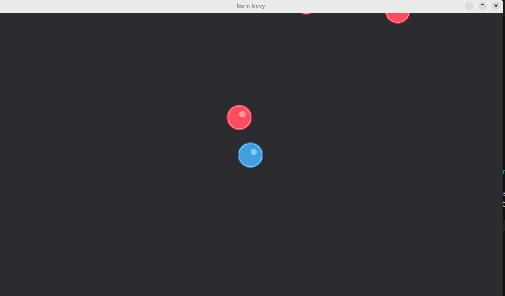
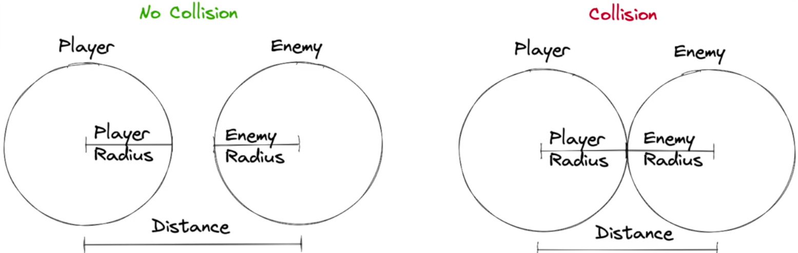

# EP4

Based on https://www.youtube.com/watch?v=4TjEo-gDgAg&list=PLVnntJRoP85JHGX7rGDu6LaF3fmDDbqyd&index=4

Learning targets
- Enemy Movement System
- Adding Sound Effects
- Pseudo-Collision Detection
- Despawn the player on game over

## Step 1
Add enemy movement

```rust
use bevy::{prelude::*, window::PrimaryWindow};
use rand::prelude::*;

pub const PLAYER_SPEED: f32 = 500.0;
pub const PLAYER_SIZE: f32 = 64.0; // This is the player sprite size.
pub const NUMBER_OF_ENEMIES: usize = 4;
pub const ENEMY_SPEED: f32 = 200.0; // This is the speed at which enemies move.

pub fn ep40() {
    App::new()
        .add_plugins(DefaultPlugins)
        .add_systems(Startup, spawn_camera)
        .add_systems(Startup, spawn_player)
        .add_systems(Startup, spawn_enemies)
        .add_systems(Update, player_movement)
        .add_systems(Update, confine_player_movement)
        .add_systems(Update, enemy_movement)
        .run();
}

#[derive(Component)]
pub struct Player {}

#[derive(Component)]
pub struct Enemy {
    pub direction: Vec2, // This is the direction in which the enemy is moving.
}

pub fn spawn_player(
    mut commands: Commands,
    window_query: Query<&Window, With<PrimaryWindow>>,
    asset_server: Res<AssetServer>,
) {
    let window = window_query.single().unwrap();

    commands.spawn((
        Sprite {
            image: asset_server.load("sprites/ball_blue_large.png"),
            ..default()
        },
        Transform::from_xyz(window.width() / 2.0, window.height() / 2.0, 0.0),
        Player {},
    ));
}

pub fn spawn_camera(mut commands: Commands, window_query: Query<&Window, With<PrimaryWindow>>) {
    let window = window_query.single().unwrap();

    commands.spawn((
        Camera2d { ..default() },
        Transform::from_xyz(window.width() / 2.0, window.height() / 2.0, 0.0),
    ));
}

pub fn spawn_enemies(
    mut commands: Commands,
    window_query: Query<&Window, With<PrimaryWindow>>,
    asset_server: Res<AssetServer>,
) {
    let window = window_query.single().unwrap();
    let mut rng = rand::rng();

    for _ in 0..NUMBER_OF_ENEMIES {
        let x = rng.random_range(0.0..window.width());
        let y = rng.random_range(0.0..window.height());

        commands.spawn((
            Sprite {
                image: asset_server.load("sprites/ball_red_large.png"),
                ..default()
            },
            Transform::from_xyz(x, y, 0.0),
            Enemy {
                direction: Vec2::new(rng.random(), rng.random()).normalize(),
            },
        ));
    }
}

pub fn player_movement(
    keyboard_input: Res<ButtonInput<KeyCode>>,
    mut player_query: Query<&mut Transform, With<Player>>,
    time: Res<Time>,
) {
    if let Ok(mut transform) = player_query.single_mut() {
        let mut direction = Vec3::ZERO;

        if keyboard_input.pressed(KeyCode::ArrowLeft)
            || keyboard_input.pressed(KeyCode::Numpad4)
            || keyboard_input.pressed(KeyCode::KeyA)
        {
            direction += Vec3::new(-1.0, 0.0, 0.0);
        }

        if keyboard_input.pressed(KeyCode::ArrowRight)
            || keyboard_input.pressed(KeyCode::Numpad6)
            || keyboard_input.pressed(KeyCode::KeyD)
        {
            direction += Vec3::new(1.0, 0.0, 0.0);
        }

        if keyboard_input.pressed(KeyCode::ArrowUp)
            || keyboard_input.pressed(KeyCode::Numpad8)
            || keyboard_input.pressed(KeyCode::KeyW)
        {
            direction += Vec3::new(0.0, 1.0, 0.0);
        }

        if keyboard_input.pressed(KeyCode::ArrowDown)
            || keyboard_input.pressed(KeyCode::Numpad2)
            || keyboard_input.pressed(KeyCode::KeyS)
        {
            direction += Vec3::new(0.0, -1.0, 0.0);
        }

        if direction.length() > 0.0 {
            direction = direction.normalize();
        }

        // using time.delta_seconds() ensures that the movement is frame-rate independent, meaning the player will move at the same speed regardless of the frame rate.
        // time is the time since the last frame, so multiplying the speed by this value ensures that the player moves at a consistent speed over time.
        transform.translation += direction * PLAYER_SPEED * time.delta_secs();
    }
}

pub fn confine_player_movement(
    mut player_query: Query<&mut Transform, With<Player>>,
    window_query: Query<&Window, With<PrimaryWindow>>,
) {
    if let Ok(mut player_transform) = player_query.single_mut() {
        let window = window_query.single().unwrap();

        let half_player_size = PLAYER_SIZE / 2.0;
        let x_min = half_player_size;
        let x_max = window.width() - half_player_size;
        let y_min = half_player_size;
        let y_max = window.height() - half_player_size;

        let mut translation = player_transform.translation;

        // Bound player x position
        if translation.x < x_min {
            translation.x = x_min;
        } else if translation.x > x_max {
            translation.x = x_max;
        }

        // Bound player y position
        if translation.y < y_min {
            translation.y = y_min;
        } else if translation.y > y_max {
            translation.y = y_max;
        }

        player_transform.translation = translation;
    }
}

pub fn enemy_movement(mut enemy_query: Query<(&mut Transform, &Enemy)>, time: Res<Time>) {
    for (mut transform, enemy) in enemy_query.iter_mut() {
        let direction: Vec3 = Vec3::new(enemy.direction.x, enemy.direction.y, 0.0);
        transform.translation += direction * ENEMY_SPEED * time.delta_secs();
    }
}
```

Running
```bash
$ cargo run 40
    Finished `dev` profile [unoptimized + debuginfo] target(s) in 0.15s
     Running `target/debug/learn-bevy 40`
2026-10-15T16:32:06.410533Z  INFO bevy_render::renderer: AdapterInfo { name: "Intel(R) Graphics (MTL)", vendor: 32902, device: 32069, device_type: IntegratedGpu, device_pci_bus_id: "0000:00:02.0", driver: "Intel open-source Mesa driver", driver_info: "Mesa 25.2.8-0ubuntu0.24.04.4", backend: Vulkan, subgroup_min_size: 8, subgroup_max_size: 32, transient_saves_memory: false }
2026-10-15T16:32:06.821224Z  INFO bevy_pbr::cluster: GPU clustering is supported on this device.
2026-10-15T16:32:06.821370Z  INFO bevy_render::batching::gpu_preprocessing: GPU preprocessing is fully supported on this device.
2026-10-15T16:32:06.823521Z  INFO bevy_winit::system: Creating new window learn-bevy (65v0)
2026-10-15T16:32:06.825119Z  INFO winit::platform_impl::linux::x11::window: Guessed window scale factor: 1
2026-10-15T16:33:25.954143Z  INFO bevy_window::system: No windows are open, exiting
2026-10-15T16:33:25.954255Z  INFO bevy_winit::system: Closing window 65v0

```
The game window startsup and the red balls (enemies) start moving


## Step 2
Confine enemies into the window

```rust
use bevy::{prelude::*, window::PrimaryWindow};
use rand::prelude::*;

pub const PLAYER_SPEED: f32 = 500.0;
pub const PLAYER_SIZE: f32 = 64.0; // This is the player sprite size.
pub const NUMBER_OF_ENEMIES: usize = 4;
pub const ENEMY_SPEED: f32 = 200.0; // This is the speed at which enemies move.
pub const ENEMY_SIZE: f32 = 64.0; // This is the enemy sprite size.

pub fn ep40() {
    App::new()
        .add_plugins(DefaultPlugins)
        .add_systems(Startup, spawn_camera)
        .add_systems(Startup, spawn_player)
        .add_systems(Startup, spawn_enemies)
        .add_systems(Update, player_movement)
        .add_systems(Update, confine_player_movement)
        .add_systems(Update, enemy_movement)
        .add_systems(Update, update_enemy_detection)
        .run();
}

#[derive(Component)]
pub struct Player {}

#[derive(Component)]
pub struct Enemy {
    pub direction: Vec2, // This is the direction in which the enemy is moving.
}

pub fn spawn_player(
    mut commands: Commands,
    window_query: Query<&Window, With<PrimaryWindow>>,
    asset_server: Res<AssetServer>,
) {
    let window = window_query.single().unwrap();

    commands.spawn((
        Sprite {
            image: asset_server.load("sprites/ball_blue_large.png"),
            ..default()
        },
        Transform::from_xyz(window.width() / 2.0, window.height() / 2.0, 0.0),
        Player {},
    ));
}

pub fn spawn_camera(mut commands: Commands, window_query: Query<&Window, With<PrimaryWindow>>) {
    let window = window_query.single().unwrap();

    commands.spawn((
        Camera2d { ..default() },
        Transform::from_xyz(window.width() / 2.0, window.height() / 2.0, 0.0),
    ));
}

pub fn spawn_enemies(
    mut commands: Commands,
    window_query: Query<&Window, With<PrimaryWindow>>,
    asset_server: Res<AssetServer>,
) {
    let window = window_query.single().unwrap();
    let mut rng = rand::rng();

    for _ in 0..NUMBER_OF_ENEMIES {
        let x = rng.random_range(0.0..window.width());
        let y = rng.random_range(0.0..window.height());

        commands.spawn((
            Sprite {
                image: asset_server.load("sprites/ball_red_large.png"),
                ..default()
            },
            Transform::from_xyz(x, y, 0.0),
            Enemy {
                direction: Vec2::new(rng.random(), rng.random()).normalize(),
            },
        ));
    }
}

pub fn player_movement(
    keyboard_input: Res<ButtonInput<KeyCode>>,
    mut player_query: Query<&mut Transform, With<Player>>,
    time: Res<Time>,
) {
    if let Ok(mut transform) = player_query.single_mut() {
        let mut direction = Vec3::ZERO;

        if keyboard_input.pressed(KeyCode::ArrowLeft)
            || keyboard_input.pressed(KeyCode::Numpad4)
            || keyboard_input.pressed(KeyCode::KeyA)
        {
            direction += Vec3::new(-1.0, 0.0, 0.0);
        }

        if keyboard_input.pressed(KeyCode::ArrowRight)
            || keyboard_input.pressed(KeyCode::Numpad6)
            || keyboard_input.pressed(KeyCode::KeyD)
        {
            direction += Vec3::new(1.0, 0.0, 0.0);
        }

        if keyboard_input.pressed(KeyCode::ArrowUp)
            || keyboard_input.pressed(KeyCode::Numpad8)
            || keyboard_input.pressed(KeyCode::KeyW)
        {
            direction += Vec3::new(0.0, 1.0, 0.0);
        }

        if keyboard_input.pressed(KeyCode::ArrowDown)
            || keyboard_input.pressed(KeyCode::Numpad2)
            || keyboard_input.pressed(KeyCode::KeyS)
        {
            direction += Vec3::new(0.0, -1.0, 0.0);
        }

        if direction.length() > 0.0 {
            direction = direction.normalize();
        }

        // using time.delta_seconds() ensures that the movement is frame-rate independent, meaning the player will move at the same speed regardless of the frame rate.
        // time is the time since the last frame, so multiplying the speed by this value ensures that the player moves at a consistent speed over time.
        transform.translation += direction * PLAYER_SPEED * time.delta_secs();
    }
}

pub fn confine_player_movement(
    mut player_query: Query<&mut Transform, With<Player>>,
    window_query: Query<&Window, With<PrimaryWindow>>,
) {
    if let Ok(mut player_transform) = player_query.single_mut() {
        let window = window_query.single().unwrap();

        let half_player_size = PLAYER_SIZE / 2.0;
        let x_min = half_player_size;
        let x_max = window.width() - half_player_size;
        let y_min = half_player_size;
        let y_max = window.height() - half_player_size;

        let mut translation = player_transform.translation;

        // Bound player x position
        if translation.x < x_min {
            translation.x = x_min;
        } else if translation.x > x_max {
            translation.x = x_max;
        }

        // Bound player y position
        if translation.y < y_min {
            translation.y = y_min;
        } else if translation.y > y_max {
            translation.y = y_max;
        }

        player_transform.translation = translation;
    }
}

pub fn enemy_movement(mut enemy_query: Query<(&mut Transform, &Enemy)>, time: Res<Time>) {
    for (mut transform, enemy) in enemy_query.iter_mut() {
        let direction: Vec3 = Vec3::new(enemy.direction.x, enemy.direction.y, 0.0);
        transform.translation += direction * ENEMY_SPEED * time.delta_secs();
    }
}

pub fn update_enemy_detection(
    mut enemy_query: Query<(&Transform, &mut Enemy)>,
    window_query: Query<&Window, With<PrimaryWindow>>,
) {
    let window = window_query.single().unwrap();
    let half_enemy_size = ENEMY_SIZE / 2.0;

    let x_min: f32 = 0.0 + half_enemy_size;
    let x_max: f32 = window.width() - half_enemy_size;
    let y_min: f32 = 0.0 + half_enemy_size;
    let y_max: f32 = window.height() - half_enemy_size;

    for (transform, mut enemy) in enemy_query.iter_mut() {
        let translation = transform.translation;

        if translation.x <= x_min || translation.x >= x_max {
            enemy.direction.x *= -1.0; // Reverse the x direction
        }

        if translation.y <= y_min || translation.y >= y_max {
            enemy.direction.y *= -1.0; // Reverse the y direction
        }
    }
}

```

Running
```bash
$ cargo run 40
    Finished `dev` profile [unoptimized + debuginfo] target(s) in 0.15s
     Running `target/debug/learn-bevy 40`
2026-10-15T16:42:27.765055Z  INFO bevy_render::renderer: AdapterInfo { name: "Intel(R) Graphics (MTL)", vendor: 32902, device: 32069, device_type: IntegratedGpu, device_pci_bus_id: "0000:00:02.0", driver: "Intel open-source Mesa driver", driver_info: "Mesa 25.2.8-0ubuntu0.24.04.4", backend: Vulkan, subgroup_min_size: 8, subgroup_max_size: 32, transient_saves_memory: false }
2026-10-15T16:42:28.178522Z  INFO bevy_pbr::cluster: GPU clustering is supported on this device.
2026-10-15T16:42:28.178695Z  INFO bevy_render::batching::gpu_preprocessing: GPU preprocessing is fully supported on this device.
2026-10-15T16:42:28.180954Z  INFO bevy_winit::system: Creating new window learn-bevy (65v0)
2026-10-15T16:42:28.183563Z  INFO winit::platform_impl::linux::x11::window: Guessed window scale factor: 1
2026-10-15T16:42:51.586424Z  INFO bevy_window::system: No windows are open, exiting
2026-10-15T16:42:51.586532Z  INFO bevy_winit::system: Closing window 65v0
```
The window opens, and the enemies (red balls) move around but stay within the window

## Step 3
Confine enemy size within window (no half enemies)

```rust
use bevy::{prelude::*, window::PrimaryWindow};
use rand::prelude::*;

pub const PLAYER_SPEED: f32 = 500.0;
pub const PLAYER_SIZE: f32 = 64.0; // This is the player sprite size.
pub const NUMBER_OF_ENEMIES: usize = 4;
pub const ENEMY_SPEED: f32 = 200.0; // This is the speed at which enemies move.
pub const ENEMY_SIZE: f32 = 64.0; // This is the enemy sprite size.

pub fn ep40() {
    App::new()
        .add_plugins(DefaultPlugins)
        .add_systems(Startup, spawn_camera)
        .add_systems(Startup, spawn_player)
        .add_systems(Startup, spawn_enemies)
        .add_systems(Update, player_movement)
        .add_systems(Update, confine_player_movement)
        .add_systems(Update, enemy_movement)
        .add_systems(Update, update_enemy_detection)
        .add_systems(Update, confine_enemy_movement)
        .run();
}

#[derive(Component)]
pub struct Player {}

#[derive(Component)]
pub struct Enemy {
    pub direction: Vec2, // This is the direction in which the enemy is moving.
}

pub fn spawn_player(
    mut commands: Commands,
    window_query: Query<&Window, With<PrimaryWindow>>,
    asset_server: Res<AssetServer>,
) {
    let window = window_query.single().unwrap();

    commands.spawn((
        Sprite {
            image: asset_server.load("sprites/ball_blue_large.png"),
            ..default()
        },
        Transform::from_xyz(window.width() / 2.0, window.height() / 2.0, 0.0),
        Player {},
    ));
}

pub fn spawn_camera(mut commands: Commands, window_query: Query<&Window, With<PrimaryWindow>>) {
    let window = window_query.single().unwrap();

    commands.spawn((
        Camera2d { ..default() },
        Transform::from_xyz(window.width() / 2.0, window.height() / 2.0, 0.0),
    ));
}

pub fn spawn_enemies(
    mut commands: Commands,
    window_query: Query<&Window, With<PrimaryWindow>>,
    asset_server: Res<AssetServer>,
) {
    let window = window_query.single().unwrap();
    let mut rng = rand::rng();

    for _ in 0..NUMBER_OF_ENEMIES {
        let x = rng.random_range(0.0..window.width());
        let y = rng.random_range(0.0..window.height());

        commands.spawn((
            Sprite {
                image: asset_server.load("sprites/ball_red_large.png"),
                ..default()
            },
            Transform::from_xyz(x, y, 0.0),
            Enemy {
                direction: Vec2::new(rng.random(), rng.random()).normalize(),
            },
        ));
    }
}

pub fn player_movement(
    keyboard_input: Res<ButtonInput<KeyCode>>,
    mut player_query: Query<&mut Transform, With<Player>>,
    time: Res<Time>,
) {
    if let Ok(mut transform) = player_query.single_mut() {
        let mut direction = Vec3::ZERO;

        if keyboard_input.pressed(KeyCode::ArrowLeft)
            || keyboard_input.pressed(KeyCode::Numpad4)
            || keyboard_input.pressed(KeyCode::KeyA)
        {
            direction += Vec3::new(-1.0, 0.0, 0.0);
        }

        if keyboard_input.pressed(KeyCode::ArrowRight)
            || keyboard_input.pressed(KeyCode::Numpad6)
            || keyboard_input.pressed(KeyCode::KeyD)
        {
            direction += Vec3::new(1.0, 0.0, 0.0);
        }

        if keyboard_input.pressed(KeyCode::ArrowUp)
            || keyboard_input.pressed(KeyCode::Numpad8)
            || keyboard_input.pressed(KeyCode::KeyW)
        {
            direction += Vec3::new(0.0, 1.0, 0.0);
        }

        if keyboard_input.pressed(KeyCode::ArrowDown)
            || keyboard_input.pressed(KeyCode::Numpad2)
            || keyboard_input.pressed(KeyCode::KeyS)
        {
            direction += Vec3::new(0.0, -1.0, 0.0);
        }

        if direction.length() > 0.0 {
            direction = direction.normalize();
        }

        // using time.delta_seconds() ensures that the movement is frame-rate independent, meaning the player will move at the same speed regardless of the frame rate.
        // time is the time since the last frame, so multiplying the speed by this value ensures that the player moves at a consistent speed over time.
        transform.translation += direction * PLAYER_SPEED * time.delta_secs();
    }
}

pub fn confine_player_movement(
    mut player_query: Query<&mut Transform, With<Player>>,
    window_query: Query<&Window, With<PrimaryWindow>>,
) {
    if let Ok(mut player_transform) = player_query.single_mut() {
        let window = window_query.single().unwrap();

        let half_player_size = PLAYER_SIZE / 2.0;
        let x_min = half_player_size;
        let x_max = window.width() - half_player_size;
        let y_min = half_player_size;
        let y_max = window.height() - half_player_size;

        let mut translation = player_transform.translation;

        // Bound player x position
        if translation.x < x_min {
            translation.x = x_min;
        } else if translation.x > x_max {
            translation.x = x_max;
        }

        // Bound player y position
        if translation.y < y_min {
            translation.y = y_min;
        } else if translation.y > y_max {
            translation.y = y_max;
        }

        player_transform.translation = translation;
    }
}

pub fn enemy_movement(mut enemy_query: Query<(&mut Transform, &Enemy)>, time: Res<Time>) {
    for (mut transform, enemy) in enemy_query.iter_mut() {
        let direction: Vec3 = Vec3::new(enemy.direction.x, enemy.direction.y, 0.0);
        transform.translation += direction * ENEMY_SPEED * time.delta_secs();
    }
}

pub fn update_enemy_detection(
    mut enemy_query: Query<(&Transform, &mut Enemy)>,
    window_query: Query<&Window, With<PrimaryWindow>>,
) {
    let window = window_query.single().unwrap();
    let half_enemy_size = ENEMY_SIZE / 2.0;

    let x_min: f32 = 0.0 + half_enemy_size;
    let x_max: f32 = window.width() - half_enemy_size;
    let y_min: f32 = 0.0 + half_enemy_size;
    let y_max: f32 = window.height() - half_enemy_size;

    for (transform, mut enemy) in enemy_query.iter_mut() {
        let translation = transform.translation;

        if translation.x <= x_min || translation.x >= x_max {
            enemy.direction.x *= -1.0; // Reverse the x direction
        }

        if translation.y <= y_min || translation.y >= y_max {
            enemy.direction.y *= -1.0; // Reverse the y direction
        }
    }
}

pub fn confine_enemy_movement(
    mut enemy_query: Query<&mut Transform, With<Enemy>>,
    window_query: Query<&Window, With<PrimaryWindow>>,
) {
    let window = window_query.single().unwrap();

    let half_enemy_size = ENEMY_SIZE / 2.0;
    let x_min = half_enemy_size;
    let x_max = window.width() - half_enemy_size;
    let y_min = half_enemy_size;
    let y_max = window.height() - half_enemy_size;

    for mut transform in enemy_query.iter_mut() {
        let mut translation = transform.translation;

        // Bound enemy x position
        if translation.x < x_min {
            translation.x = x_min;
        } else if translation.x > x_max {
            translation.x = x_max;
        }

        // Bound enemy y position
        if translation.y < y_min {
            translation.y = y_min;
        } else if translation.y > y_max {
            translation.y = y_max;
        }

        transform.translation = translation;
    }
}

```

```bash
$ cargo run 40
   Compiling learn-bevy v0.1.0 (/home/bvpelt/Develop/learn-bevy)
    Finished `dev` profile [unoptimized + debuginfo] target(s) in 1.02s
     Running `target/debug/learn-bevy 40`
2026-10-15T16:53:02.481527Z  INFO bevy_render::renderer: AdapterInfo { name: "Intel(R) Graphics (MTL)", vendor: 32902, device: 32069, device_type: IntegratedGpu, device_pci_bus_id: "0000:00:02.0", driver: "Intel open-source Mesa driver", driver_info: "Mesa 25.2.8-0ubuntu0.24.04.4", backend: Vulkan, subgroup_min_size: 8, subgroup_max_size: 32, transient_saves_memory: false }
2026-10-15T16:53:02.886038Z  INFO bevy_pbr::cluster: GPU clustering is supported on this device.
2026-10-15T16:53:02.886232Z  INFO bevy_render::batching::gpu_preprocessing: GPU preprocessing is fully supported on this device.
2026-10-15T16:53:02.888595Z  INFO bevy_winit::system: Creating new window learn-bevy (65v0)
2026-10-15T16:53:02.890291Z  INFO winit::platform_impl::linux::x11::window: Guessed window scale factor: 1
2026-10-15T16:53:16.619178Z  INFO bevy_window::system: No windows are open, exiting
2026-10-15T16:53:16.619303Z  INFO bevy_winit::system: Closing window 65v0

```
The game window starts up, the enemies move as whole enemies within the game window.

## Step 4
Add sound

```rust
use bevy::{prelude::*, window::PrimaryWindow};
use rand::prelude::*;

pub const PLAYER_SPEED: f32 = 500.0;
pub const PLAYER_SIZE: f32 = 64.0; // This is the player sprite size.
pub const NUMBER_OF_ENEMIES: usize = 4;
pub const ENEMY_SPEED: f32 = 200.0; // This is the speed at which enemies move.
pub const ENEMY_SIZE: f32 = 64.0; // This is the enemy sprite size.

pub fn ep40() {
    App::new()
        .add_plugins(DefaultPlugins)
        .add_systems(Startup, spawn_camera)
        .add_systems(Startup, spawn_player)
        .add_systems(Startup, spawn_enemies)
        .add_systems(Update, player_movement)
        .add_systems(Update, confine_player_movement)
        .add_systems(Update, enemy_movement)
        .add_systems(Update, update_enemy_detection)
        .add_systems(Update, confine_enemy_movement)
        .run();
}

#[derive(Component)]
pub struct Player {}

#[derive(Component)]
pub struct Enemy {
    pub direction: Vec2, // This is the direction in which the enemy is moving.
}

pub fn spawn_player(
    mut commands: Commands,
    window_query: Query<&Window, With<PrimaryWindow>>,
    asset_server: Res<AssetServer>,
) {
    let window = window_query.single().unwrap();

    commands.spawn((
        Sprite {
            image: asset_server.load("sprites/ball_blue_large.png"),
            ..default()
        },
        Transform::from_xyz(window.width() / 2.0, window.height() / 2.0, 0.0),
        Player {},
    ));
}

pub fn spawn_camera(mut commands: Commands, window_query: Query<&Window, With<PrimaryWindow>>) {
    let window = window_query.single().unwrap();

    commands.spawn((
        Camera2d { ..default() },
        Transform::from_xyz(window.width() / 2.0, window.height() / 2.0, 0.0),
    ));
}

pub fn spawn_enemies(
    mut commands: Commands,
    window_query: Query<&Window, With<PrimaryWindow>>,
    asset_server: Res<AssetServer>,
) {
    let window = window_query.single().unwrap();
    let mut rng = rand::rng();
    let enemy_half_size = ENEMY_SIZE / 2.0;
    for _ in 0..NUMBER_OF_ENEMIES {
        let x = rng.random_range(enemy_half_size..window.width() - enemy_half_size);
        let y = rng.random_range(enemy_half_size..window.height() - enemy_half_size);

        commands.spawn((
            Sprite {
                image: asset_server.load("sprites/ball_red_large.png"),
                ..default()
            },
            Transform::from_xyz(x, y, 0.0),
            Enemy {
                direction: Vec2::new(rng.random(), rng.random()).normalize(),
            },
        ));
    }
}

pub fn player_movement(
    keyboard_input: Res<ButtonInput<KeyCode>>,
    mut player_query: Query<&mut Transform, With<Player>>,
    time: Res<Time>,
) {
    if let Ok(mut transform) = player_query.single_mut() {
        let mut direction = Vec3::ZERO;

        if keyboard_input.pressed(KeyCode::ArrowLeft)
            || keyboard_input.pressed(KeyCode::Numpad4)
            || keyboard_input.pressed(KeyCode::KeyA)
        {
            direction += Vec3::new(-1.0, 0.0, 0.0);
        }

        if keyboard_input.pressed(KeyCode::ArrowRight)
            || keyboard_input.pressed(KeyCode::Numpad6)
            || keyboard_input.pressed(KeyCode::KeyD)
        {
            direction += Vec3::new(1.0, 0.0, 0.0);
        }

        if keyboard_input.pressed(KeyCode::ArrowUp)
            || keyboard_input.pressed(KeyCode::Numpad8)
            || keyboard_input.pressed(KeyCode::KeyW)
        {
            direction += Vec3::new(0.0, 1.0, 0.0);
        }

        if keyboard_input.pressed(KeyCode::ArrowDown)
            || keyboard_input.pressed(KeyCode::Numpad2)
            || keyboard_input.pressed(KeyCode::KeyS)
        {
            direction += Vec3::new(0.0, -1.0, 0.0);
        }

        if direction.length() > 0.0 {
            direction = direction.normalize();
        }

        // using time.delta_seconds() ensures that the movement is frame-rate independent, meaning the player will move at the same speed regardless of the frame rate.
        // time is the time since the last frame, so multiplying the speed by this value ensures that the player moves at a consistent speed over time.
        transform.translation += direction * PLAYER_SPEED * time.delta_secs();
    }
}

pub fn confine_player_movement(
    mut player_query: Query<&mut Transform, With<Player>>,
    window_query: Query<&Window, With<PrimaryWindow>>,
) {
    if let Ok(mut player_transform) = player_query.single_mut() {
        let window = window_query.single().unwrap();

        let half_player_size = PLAYER_SIZE / 2.0;
        let x_min = half_player_size;
        let x_max = window.width() - half_player_size;
        let y_min = half_player_size;
        let y_max = window.height() - half_player_size;

        let mut translation = player_transform.translation;

        // Bound player x position
        if translation.x < x_min {
            translation.x = x_min;
        } else if translation.x > x_max {
            translation.x = x_max;
        }

        // Bound player y position
        if translation.y < y_min {
            translation.y = y_min;
        } else if translation.y > y_max {
            translation.y = y_max;
        }

        player_transform.translation = translation;
    }
}

pub fn enemy_movement(mut enemy_query: Query<(&mut Transform, &Enemy)>, time: Res<Time>) {
    for (mut transform, enemy) in enemy_query.iter_mut() {
        let direction: Vec3 = Vec3::new(enemy.direction.x, enemy.direction.y, 0.0);
        transform.translation += direction * ENEMY_SPEED * time.delta_secs();
    }
}

pub fn update_enemy_detection(
    mut enemy_query: Query<(&Transform, &mut Enemy)>,
    window_query: Query<&Window, With<PrimaryWindow>>,
    mut commands: Commands,
    asset_server: Res<AssetServer>,
) {
    let window = window_query.single().unwrap();
    let half_enemy_size = ENEMY_SIZE / 2.0;

    let x_min: f32 = 0.0 + half_enemy_size;
    let x_max: f32 = window.width() - half_enemy_size;
    let y_min: f32 = 0.0 + half_enemy_size;
    let y_max: f32 = window.height() - half_enemy_size;

    for (transform, mut enemy) in enemy_query.iter_mut() {
        let mut direction_changed: bool = false;

        let translation = transform.translation;

        if translation.x <= x_min || translation.x >= x_max {
            enemy.direction.x *= -1.0; // Reverse the x direction
            direction_changed = true;
        }

        if translation.y <= y_min || translation.y >= y_max {
            enemy.direction.y *= -1.0; // Reverse the y direction
            direction_changed = true;
        }

        // if direction changed play sound effect
        if direction_changed {
            let sound_effect_1 = asset_server.load("audio/pluck_001.ogg");
            let sound_effect_2 = asset_server.load("audio/pluck_002.ogg");
            // random play sound effect 1 or 2
            let sound_effect = if rand::random_range(0.0..1.0) > 0.5 {
                sound_effect_1
            } else {
                sound_effect_2
            };
            commands.spawn(AudioPlayer::new(sound_effect));
        }
    }
}

pub fn confine_enemy_movement(
    mut enemy_query: Query<&mut Transform, With<Enemy>>,
    window_query: Query<&Window, With<PrimaryWindow>>,
) {
    let window = window_query.single().unwrap();

    let half_enemy_size = ENEMY_SIZE / 2.0;
    let x_min = half_enemy_size;
    let x_max = window.width() - half_enemy_size;
    let y_min = half_enemy_size;
    let y_max = window.height() - half_enemy_size;

    for mut transform in enemy_query.iter_mut() {
        let mut translation = transform.translation;

        // Bound enemy x position
        if translation.x < x_min {
            translation.x = x_min;
        } else if translation.x > x_max {
            translation.x = x_max;
        }

        // Bound enemy y position
        if translation.y < y_min {
            translation.y = y_min;
        } else if translation.y > y_max {
            translation.y = y_max;
        }

        transform.translation = translation;
    }
}

```

```bash
$ cargo run 40
   Compiling learn-bevy v0.1.0 (/home/bvpelt/Develop/learn-bevy)
    Finished `dev` profile [unoptimized + debuginfo] target(s) in 1.46s
     Running `target/debug/learn-bevy 40`
2026-10-15T17:11:27.292404Z  INFO bevy_render::renderer: AdapterInfo { name: "Intel(R) Graphics (MTL)", vendor: 32902, device: 32069, device_type: IntegratedGpu, device_pci_bus_id: "0000:00:02.0", driver: "Intel open-source Mesa driver", driver_info: "Mesa 25.2.8-0ubuntu0.24.04.4", backend: Vulkan, subgroup_min_size: 8, subgroup_max_size: 32, transient_saves_memory: false }
2026-10-15T17:11:27.697907Z  INFO bevy_pbr::cluster: GPU clustering is supported on this device.
2026-10-15T17:11:27.698036Z  INFO bevy_render::batching::gpu_preprocessing: GPU preprocessing is fully supported on this device.
2026-10-15T17:11:27.700246Z  INFO bevy_winit::system: Creating new window learn-bevy (65v0)
2026-10-15T17:11:27.702593Z  INFO winit::platform_impl::linux::x11::window: Guessed window scale factor: 1
2026-10-15T17:11:28.202334Z ERROR rodio::stream: audio stream error: Buffer underrun/overrun occurred.
2026-10-15T17:11:50.251441Z  INFO bevy_window::system: No windows are open, exiting
2026-10-15T17:11:50.251551Z  INFO bevy_winit::system: Closing window 65v0

```
The window opens, enemies move. When an enemie hits the game window border a sound is played.

## Step 5
Detect a hit for player and enemy

To detect a collision the size of the player and enemy if needed



```rust
use bevy::{prelude::*, window::PrimaryWindow};
use rand::prelude::*;

pub const PLAYER_SPEED: f32 = 500.0;
pub const PLAYER_SIZE: f32 = 64.0; // This is the player sprite size.
pub const NUMBER_OF_ENEMIES: usize = 4;
pub const ENEMY_SPEED: f32 = 200.0; // This is the speed at which enemies move.
pub const ENEMY_SIZE: f32 = 64.0; // This is the enemy sprite size.
pub const PLAY_SOUNDS: bool = true;

pub fn ep40() {
    App::new()
        .add_plugins(DefaultPlugins)
        .add_systems(Startup, spawn_camera)
        .add_systems(Startup, spawn_player)
        .add_systems(Startup, spawn_enemies)
        .add_systems(Update, player_movement)
        .add_systems(Update, confine_player_movement)
        .add_systems(Update, enemy_movement)
        .add_systems(Update, update_enemy_detection)
        .add_systems(Update, confine_enemy_movement)
        .add_systems(Update, enemy_hit_player)
        .run();
}

#[derive(Component)]
pub struct Player {}

#[derive(Component)]
pub struct Enemy {
    pub direction: Vec2, // This is the direction in which the enemy is moving.
}

pub fn spawn_player(
    mut commands: Commands,
    window_query: Query<&Window, With<PrimaryWindow>>,
    asset_server: Res<AssetServer>,
) {
    let window = window_query.single().unwrap();

    commands.spawn((
        Sprite {
            image: asset_server.load("sprites/ball_blue_large.png"),
            ..default()
        },
        Transform::from_xyz(window.width() / 2.0, window.height() / 2.0, 0.0),
        Player {},
    ));
}

pub fn spawn_camera(mut commands: Commands, window_query: Query<&Window, With<PrimaryWindow>>) {
    let window = window_query.single().unwrap();

    commands.spawn((
        Camera2d { ..default() },
        Transform::from_xyz(window.width() / 2.0, window.height() / 2.0, 0.0),
    ));
}

pub fn spawn_enemies(
    mut commands: Commands,
    window_query: Query<&Window, With<PrimaryWindow>>,
    asset_server: Res<AssetServer>,
) {
    let window = window_query.single().unwrap();
    let mut rng = rand::rng();
    let enemy_half_size = ENEMY_SIZE / 2.0;
    for _ in 0..NUMBER_OF_ENEMIES {
        let x = rng.random_range(enemy_half_size..window.width() - enemy_half_size);
        let y = rng.random_range(enemy_half_size..window.height() - enemy_half_size);

        commands.spawn((
            Sprite {
                image: asset_server.load("sprites/ball_red_large.png"),
                ..default()
            },
            Transform::from_xyz(x, y, 0.0),
            Enemy {
                direction: Vec2::new(rng.random(), rng.random()).normalize(),
            },
        ));
    }
}

pub fn player_movement(
    keyboard_input: Res<ButtonInput<KeyCode>>,
    mut player_query: Query<&mut Transform, With<Player>>,
    time: Res<Time>,
) {
    if let Ok(mut transform) = player_query.single_mut() {
        let mut direction = Vec3::ZERO;

        if keyboard_input.pressed(KeyCode::ArrowLeft)
            || keyboard_input.pressed(KeyCode::Numpad4)
            || keyboard_input.pressed(KeyCode::KeyA)
        {
            direction += Vec3::new(-1.0, 0.0, 0.0);
        }

        if keyboard_input.pressed(KeyCode::ArrowRight)
            || keyboard_input.pressed(KeyCode::Numpad6)
            || keyboard_input.pressed(KeyCode::KeyD)
        {
            direction += Vec3::new(1.0, 0.0, 0.0);
        }

        if keyboard_input.pressed(KeyCode::ArrowUp)
            || keyboard_input.pressed(KeyCode::Numpad8)
            || keyboard_input.pressed(KeyCode::KeyW)
        {
            direction += Vec3::new(0.0, 1.0, 0.0);
        }

        if keyboard_input.pressed(KeyCode::ArrowDown)
            || keyboard_input.pressed(KeyCode::Numpad2)
            || keyboard_input.pressed(KeyCode::KeyS)
        {
            direction += Vec3::new(0.0, -1.0, 0.0);
        }

        if direction.length() > 0.0 {
            direction = direction.normalize();
        }

        // using time.delta_seconds() ensures that the movement is frame-rate independent, meaning the player will move at the same speed regardless of the frame rate.
        // time is the time since the last frame, so multiplying the speed by this value ensures that the player moves at a consistent speed over time.
        transform.translation += direction * PLAYER_SPEED * time.delta_secs();
    }
}

pub fn confine_player_movement(
    mut player_query: Query<&mut Transform, With<Player>>,
    window_query: Query<&Window, With<PrimaryWindow>>,
) {
    if let Ok(mut player_transform) = player_query.single_mut() {
        let window = window_query.single().unwrap();

        let half_player_size = PLAYER_SIZE / 2.0;
        let x_min = half_player_size;
        let x_max = window.width() - half_player_size;
        let y_min = half_player_size;
        let y_max = window.height() - half_player_size;

        let mut translation = player_transform.translation;

        // Bound player x position
        if translation.x < x_min {
            translation.x = x_min;
        } else if translation.x > x_max {
            translation.x = x_max;
        }

        // Bound player y position
        if translation.y < y_min {
            translation.y = y_min;
        } else if translation.y > y_max {
            translation.y = y_max;
        }

        player_transform.translation = translation;
    }
}

pub fn enemy_movement(mut enemy_query: Query<(&mut Transform, &Enemy)>, time: Res<Time>) {
    for (mut transform, enemy) in enemy_query.iter_mut() {
        let direction: Vec3 = Vec3::new(enemy.direction.x, enemy.direction.y, 0.0);
        transform.translation += direction * ENEMY_SPEED * time.delta_secs();
    }
}

pub fn update_enemy_detection(
    mut enemy_query: Query<(&Transform, &mut Enemy)>,
    window_query: Query<&Window, With<PrimaryWindow>>,
    mut commands: Commands,
    asset_server: Res<AssetServer>,
) {
    let window = window_query.single().unwrap();
    let half_enemy_size = ENEMY_SIZE / 2.0;

    let x_min: f32 = 0.0 + half_enemy_size;
    let x_max: f32 = window.width() - half_enemy_size;
    let y_min: f32 = 0.0 + half_enemy_size;
    let y_max: f32 = window.height() - half_enemy_size;

    for (transform, mut enemy) in enemy_query.iter_mut() {
        let mut direction_changed: bool = false;

        let translation = transform.translation;

        if translation.x <= x_min || translation.x >= x_max {
            enemy.direction.x *= -1.0; // Reverse the x direction
            direction_changed = true;
        }

        if translation.y <= y_min || translation.y >= y_max {
            enemy.direction.y *= -1.0; // Reverse the y direction
            direction_changed = true;
        }

        // if direction changed play sound effect
        if direction_changed && PLAY_SOUNDS {
            let sound_effect_1 = asset_server.load("audio/pluck_001.ogg");
            let sound_effect_2 = asset_server.load("audio/pluck_002.ogg");
            // random play sound effect 1 or 2
            let sound_effect = if rand::random_range(0.0..1.0) > 0.5 {
                sound_effect_1
            } else {
                sound_effect_2
            };
            commands.spawn(AudioPlayer::new(sound_effect));
        }
    }
}

pub fn confine_enemy_movement(
    mut enemy_query: Query<&mut Transform, With<Enemy>>,
    window_query: Query<&Window, With<PrimaryWindow>>,
) {
    let window = window_query.single().unwrap();

    let half_enemy_size = ENEMY_SIZE / 2.0;
    let x_min = half_enemy_size;
    let x_max = window.width() - half_enemy_size;
    let y_min = half_enemy_size;
    let y_max = window.height() - half_enemy_size;

    for mut transform in enemy_query.iter_mut() {
        let mut translation = transform.translation;

        // Bound enemy x position
        if translation.x < x_min {
            translation.x = x_min;
        } else if translation.x > x_max {
            translation.x = x_max;
        }

        // Bound enemy y position
        if translation.y < y_min {
            translation.y = y_min;
        } else if translation.y > y_max {
            translation.y = y_max;
        }

        transform.translation = translation;
    }
}

pub fn enemy_hit_player(
    mut commands: Commands,
    mut player_query: Query<(Entity, &Transform), With<Player>>,
    enemy_query: Query<&Transform, With<Enemy>>,
    asset_server: Res<AssetServer>,
) {
    if let Ok((player_entity, player_transform)) = player_query.single_mut() {
        for enemy_transform in enemy_query.iter() {
            let distance = player_transform
                .translation
                .distance(enemy_transform.translation);
            let player_radius = PLAYER_SIZE / 2.0;
            let enemy_radius = ENEMY_SIZE / 2.0;

            // collision detection between player and enemy
            if distance < player_radius + enemy_radius {
                println!("Player hit by enemy!, Game Over!");

                if PLAY_SOUNDS {
                    let sound_effect = asset_server.load("audio/explosionCrunch_000.ogg");
                    commands.spawn(AudioPlayer::new(sound_effect));
                }
                commands.entity(player_entity).despawn();
            }
        }
    }
}

```

Running
```bash
$ cargo run 40
   Compiling learn-bevy v0.1.0 (/home/bvpelt/Develop/learn-bevy)
    Finished `dev` profile [unoptimized + debuginfo] target(s) in 1.18s
     Running `target/debug/learn-bevy 40`
2026-10-16T09:28:54.959121Z  INFO bevy_render::renderer: AdapterInfo { name: "Intel(R) Graphics (MTL)", vendor: 32902, device: 32069, device_type: IntegratedGpu, device_pci_bus_id: "0000:00:02.0", driver: "Intel open-source Mesa driver", driver_info: "Mesa 25.2.8-0ubuntu0.24.04.4", backend: Vulkan, subgroup_min_size: 8, subgroup_max_size: 32, transient_saves_memory: false }
2026-10-16T09:28:55.365639Z  INFO bevy_pbr::cluster: GPU clustering is supported on this device.
2026-10-16T09:28:55.365765Z  INFO bevy_render::batching::gpu_preprocessing: GPU preprocessing is fully supported on this device.
2026-10-16T09:28:55.368035Z  INFO bevy_winit::system: Creating new window learn-bevy (65v0)
2026-10-16T09:28:55.371174Z  INFO winit::platform_impl::linux::x11::window: Guessed window scale factor: 1
Player hit by enemy!, Game Over!
2026-10-16T09:29:15.151714Z  INFO bevy_window::system: No windows are open, exiting
2026-10-16T09:29:15.151831Z  INFO bevy_winit::system: Closing window 65v0

```
The window opens, when an enemy hits the game window a sound is played and the direction of enemy movement is changed. When an enemy hits the player, a sound is played and the player is removed (despawned) from the game.