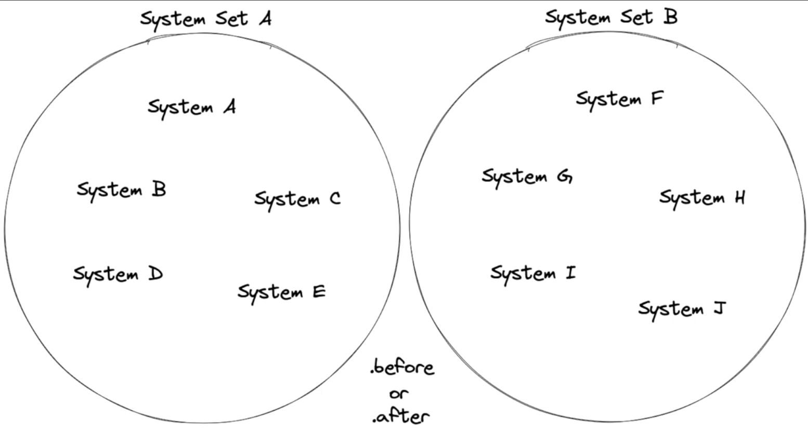

# EP8

Based on https://www.youtube.com/watch?v=i-Wczghlmxc&list=PLVnntJRoP85JHGX7rGDu6LaF3fmDDbqyd&index=8

Learning targets
- explicit system ordering
    - using before and after methods
    - using SystemSets

Bevy systems do not run in a specific order by default.
The order systems are run is non-deterministic.

This means:
- for every input there can be many different outputs
- likely to have a different result each time

Bevy's scheduling algorithm looks at the signature of all 
our systems to get this information as input, and it's output
is the order of our systems.

The order of execution of the systems can vary on each run of the game and even on each frame in the game.

A warning about using to much explicit system ordering.
It takes away degrees of freedom for the bevy scheduling system to run systems in parallel resulting in worse performance.

An other way to order the sequence is using systemsets. 



You place systems in systemset A or B and then define that systemset B should run after systemset A.

## Step 1
Explicitly define the order using
- before or after
- chaining

As an example the player systems player_movement and confine_player_movement from player/mod.rs are used

### Before or after

```rust
use bevy::prelude::*;

pub mod components;
mod systems;

use systems::*;

pub struct PlayerPlugin;

impl Plugin for PlayerPlugin {
    fn build(&self, app: &mut App) {
        app
            // Startup system
            .add_systems(Startup, spawn_player)
            // Systems
            .add_systems(Update, player_movement)
            .add_systems(Update, confine_player_movement.after(player_movement))
            .add_systems(Update, enemy_hit_player)
            .add_systems(Update, player_hit_star);
    }
}
```

### Chaining

```rust
use bevy::prelude::*;

pub mod components;
mod systems;

use systems::*;

pub struct PlayerPlugin;

impl Plugin for PlayerPlugin {
    fn build(&self, app: &mut App) {
        app
            // Startup system
            .add_systems(Startup, spawn_player)
            // Systems
            .add_systems(Update, (
                player_movement,
                confine_player_movement
            ).chain())
            .add_systems(Update, enemy_hit_player)
            .add_systems(Update, player_hit_star);
    }
}
```

## Step 2

Using systemsets

```rust
use bevy::prelude::*;

pub mod components;
mod systems;

use systems::*;

#[derive(SystemSet, Debug, Hash, PartialEq, Eq, Clone)]
pub struct MovementSystemSet;

#[derive(SystemSet, Debug, Hash, PartialEq, Eq, Clone)]

pub struct ConfinementSystemSet;

pub struct PlayerPlugin;

impl Plugin for PlayerPlugin {
    fn build(&self, app: &mut App) {
        app.configure_sets(Update, MovementSystemSet.before(ConfinementSystemSet))
            // Startup system
            .add_systems(Startup, spawn_player)
            .add_systems(Update, player_movement.in_set(MovementSystemSet))
            .add_systems(Update, confine_player_movement.in_set(ConfinementSystemSet))
            .add_systems(Update, enemy_hit_player)
            .add_systems(Update, player_hit_star);
    }
}

```

Using systemsets as enum

```rust
use bevy::prelude::*;

pub mod components;
mod systems;

use systems::*;

#[derive(SystemSet, Debug, Hash, PartialEq, Eq, Clone)]
pub enum PlayerSystemSet {
    Movement,
    Confinement,
}

pub struct PlayerPlugin;

impl Plugin for PlayerPlugin {
    fn build(&self, app: &mut App) {
        app
            //
            .configure_sets(
                Update,
                PlayerSystemSet::Movement.before(PlayerSystemSet::Confinement),
            )
            // Startup system
            .add_systems(Startup, spawn_player)
            // Systems
            .add_systems(Update, player_movement.in_set(PlayerSystemSet::Movement))
            .add_systems(
                Update,
                confine_player_movement.in_set(PlayerSystemSet::Confinement),
            )
            .add_systems(Update, enemy_hit_player)
            .add_systems(Update, player_hit_star);
    }
}
```